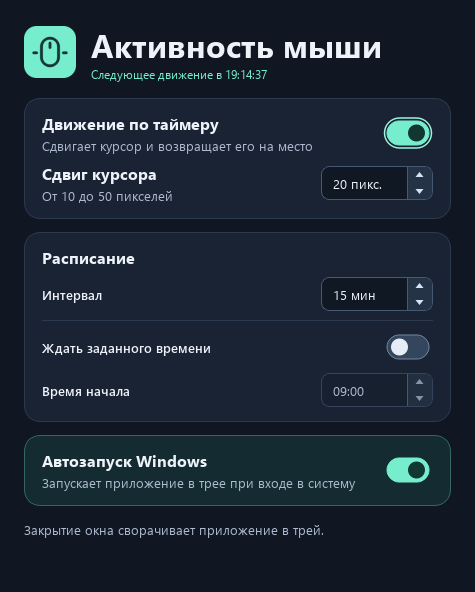

# MouseActivity

**Движение курсора по расписанию в Windows.** MouseActivity через заданный интервал сдвигает курсор и сразу возвращает его на исходное место. Приложение работает в трее и может запускаться автоматически при входе в Windows.

<p align="center">
  
</p>

## Быстрый запуск

1. Откройте `dist\MouseActivity.exe`. Если у вас только исходники, сначала [соберите EXE](#сборка-exe).
2. Включите **«Движение по таймеру»**. По умолчанию курсор сдвигается на **20 пикселей** каждые **15 минут**.
3. Проверьте время следующего движения под заголовком окна. Приложение продолжит работать после закрытия окна.

## Настройки

| Настройка | Как работает |
| --- | --- |
| **Сдвиг курсора** | От **10 до 50 пикселей**. У края экрана движение выполняется в другую сторону. Если в обе стороны не хватает места для полного сдвига, программа пропускает этот цикл. |
| **Интервал** | От **1 до 1 440 минут** между движениями. |
| **Ждать заданного времени** | Если время начала сегодня ещё не наступило, таймер ждёт его. Если оно уже прошло, таймер отсчитывает обычный интервал. |
| **Автозапуск Windows** | Запускает приложение в трее при входе в систему. Чтобы привязать автозапуск к другой копии EXE, откройте её и переключите настройку с «выкл.» на «вкл.». Если настройка уже включена, сначала выключите её. |

Чтобы вернуться к настройкам, нажмите на значок MouseActivity в трее. В контекстном меню значка можно приостановить или возобновить таймер и полностью завершить программу через **«Выход»**.

## Как проверить работу

Поставьте интервал **1 минута**, выключите ожидание заданного времени и включите движение по таймеру. После указанного под заголовком времени окно должно показать время следующего цикла. Сдвиг и возврат отправляются подряд, поэтому движение курсора легко не заметить. Если вы проверяете реакцию другой программы, наблюдайте за её статусом активности. Каждая программа сама определяет, какие события ввода учитывать.

## Сборка EXE

Для сборки нужен **64-разрядный Python 3.12** на Windows. В PowerShell выполните:

```powershell
git clone https://github.com/rvburov/MouseActivity.git
cd MouseActivity
powershell.exe -NoProfile -ExecutionPolicy Bypass -File .\build.ps1
```

При первом запуске с Python из нестандартной папки передайте путь явно:

```powershell
powershell.exe -NoProfile -ExecutionPolicy Bypass -File .\build.ps1 -PythonPath 'C:\path\to\python.exe'
```

Скрипт создаёт виртуальное окружение `.venv`, устанавливает зависимости из `requirements.txt` и собирает через PyInstaller один файл `dist\MouseActivity.exe` со встроенным значком. Готовый EXE запускается без установленного Python.
